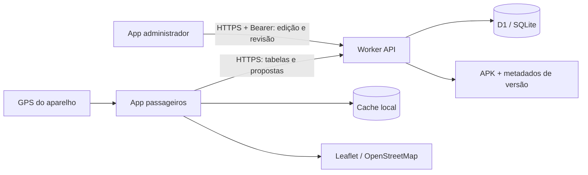

# Arquitetura

## Responsabilidades

No app de passageiros, Schedule representa as tabelas; CloudDatabase sincroniza e guarda o cache; RoadGeometry interpreta vias e referências públicas; RoadForecast projeta o ponto de embarque e calcula passagens em cada sentido. MainActivity exibe a consulta. MapPickerActivity permite escolher um ponto e mostrar a posição atual.

AppUpdates consulta a versão disponível e valida tamanho, SHA-256, pacote, versão e certificado antes de iniciar o instalador. UpdatePolicy concentra as regras puras; ApkProvider concede leitura apenas ao arquivo de atualização esperado.

O administrador usa outro pacote Android e outra interface. Sugestões ficam pendentes; somente a revisão autenticada pode aplicá-las. Pausar o recebimento não apaga propostas anteriores.

## Dados e limites

O GPS usado para previsão é processado no aparelho. Uma sugestão enviada pode conter a coordenada escolhida pelo usuário. O mapa carrega tiles de terceiros. As geometrias públicas usam tempos relativos da via e são ajustadas à duração entre horários de referência, sem afirmar que o ônibus está em uma posição real.

O SQLite local é cache; o D1 é a fonte compartilhada. Cada alteração de dados oficiais incrementa a revisão. As migrações históricas permanecem imutáveis, inclusive uma tabela antiga de configuração do Google Maps hoje inativa.

Amanari e a origem de Umarizeiras exigem confirmação. A interface e a API ainda têm partes concentradas em classes grandes; a extração progressiva por função está descrita no roadmap.
